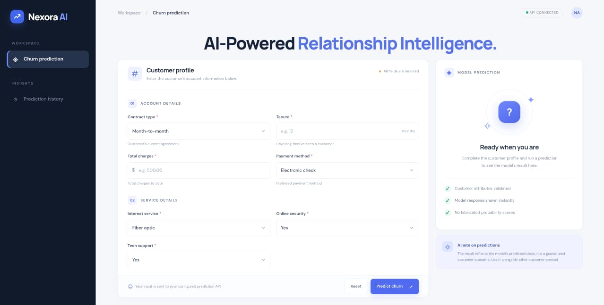

<a id="top"></a>

<div align="center">


<br>

 
<br><br>


<br><br>
</div>

<div align="center">

# ◈ Intelligence Begins With a Question
### *What if we could predict a customer's departure before it happens?*
---
</div>

# ✦ The Origin Story

Every meaningful project begins with an observation. **Nexora AI began with a real-world business problem.**

Last Sunday, I visited a friend who runs a telecom dealership. During our conversation, I noticed his concern about declining sales as customers switched between telecom operators.

It made me think: businesses often realize they are losing customers only after those customers have already left.

**But what if data could reveal the warning signs earlier?**

That question sparked Nexora AI — a machine learning project designed to identify customers at risk of churning and help businesses explore proactive retention strategies.

> *Not just understanding what happened. Anticipating what could happen next.*

---

# ⌘ The Mission

<div align="center">

| ◈ ANALYZE | ◈ PREDICT | ◈ RETAIN |
|:---:|:---:|:---:|
| Discover customer behavior patterns. | Identify potential churn risks. | Support smarter retention decisions. |

</div>

Nexora AI aims to transform raw customer data into useful business intelligence.

- **Behavioral insights** — Explore patterns associated with customer churn.
- **Predictive modeling** — Estimate the likelihood of customers leaving.
- **Risk identification** — Help prioritize customers who may need attention.
- **Retention intelligence** — Inform relevant offers and service improvements.

---


# ⚡ The Technology Universe

<div align="left">

| Technology | Role in Nexora AI |
|:---|:---|
|  **Python** | Core development |
|  **Pandas** | Data manipulation |
| **NumPy** | Numerical computation |
| **Matplotlib & Seaborn** | Data visualization |
| **Scikit-learn** | Model training and evaluation |
| **Jupyter Notebook** | Analysis and experimentation |

</div>

<sub>Technology list is a suggested stack. Retain only the tools used in the actual project.</sub>

---

# ◈ The Metrics That Matter

A useful churn model needs more than accuracy. It needs to identify at-risk customers while helping businesses prioritize their retention efforts.

<div align="center">

| Metric | What it tells us |
|:---:|:---|
| **Precision** | How reliable are positive churn predictions? |
| **Recall** | How many actual churn cases are identified? |
| **F1-Score** | How well are precision and recall balanced? |
| **ROC-AUC** | How well can the model distinguish churn from non-churn? |

</div>

**Current model performance:** To be added after evaluation.

---

# ⭐ Project Layout
 
```text
churniq_website/
├── main.py
├── model.pkl        # Add your trained model file here
├── requirements.txt
└── static/
    ├── index.html
    ├── styles.css
    └── app.js
```
# 🚀 Launch Nexora AI Locally

**01 — Clone the repository**

```bash
git clone https://github.com/YOUR-USERNAME/Nexora-AI.git
cd Nexora-AI
```

**02 — Create a virtual environment**

```bash
python -m venv venv
```

**03 — Activate the environment**

```bash
# Windows
venv\Scripts\activate

# macOS / Linux
source venv/bin/activate
```

**04 — Install dependencies**

```bash
pip install -r requirements.txt
```

**05 — Start exploring**

```bash
jupyter notebook
```

Open the relevant notebook and follow the implemented analysis workflow.

---

# ✧ Future Vision

<div align="center">

| Status | Enhancement |
|:---:|:---|
| ◉ Planned | Interactive churn prediction dashboard |
| ◉ Planned | Customer-level churn probability scores |
| ◉ Planned | Explainable AI and churn-driver analysis |
| ◉ Planned | Personalized retention recommendations |
| ◉ Planned | Model monitoring and performance tracking |

</div>

*These are potential enhancements, not claims about completed features.*

---

# ⌘ Beyond Prediction

<div align="center">

### From Reactive Decisions to Predictive Intelligence.

A customer leaving is an outcome. Understanding the risk before it happens creates an opportunity to act.

Nexora AI explores how machine learning can help businesses move from looking at past losses to making more informed decisions about customer retention.

<br/>

**The question isn't only who we lost.**

### It's who we could lose next — and what we can do about it.

</div>

---

# 🤝 Let's Connect

Building Nexora AI is part of my journey into machine learning, predictive analytics, and solving real-world business problems.

**Interested in AI, data science, or customer analytics?** Let's connect, exchange ideas, and learn together.

If you find this project interesting, consider giving it a ⭐ on GitHub.


</div>
<div align="center">
  
# ✦ NEXORA AI

<div align="center">

<a href="mailto:piyushagarwal146@gmail.com">&nbsp; <b>Mail</b></a>&nbsp;&nbsp;&nbsp;&nbsp;
<a href="https://dashefy.vercel.app/">&nbsp; <b>Portfolio</b></a>&nbsp;&nbsp;&nbsp;&nbsp;
<a href="https://www.linkedin.com/in/piyush-agarwal-1a93003a1">&nbsp; <b>LinkedIn</b></a>&nbsp;&nbsp;&nbsp;&nbsp;
<a href="https://hub.docker.com/repository/docker/piyushagarwal04/nexora_ai/general">&nbsp; <b>Docker</b></a>&nbsp;&nbsp;&nbsp;&nbsp;
<a href="https://github.com/YOUR_USERNAME">&nbsp; <b>Git</b></a>&nbsp;&nbsp;&nbsp;&nbsp;&nbsp;&nbsp;

</div>

<br/>
</div>


